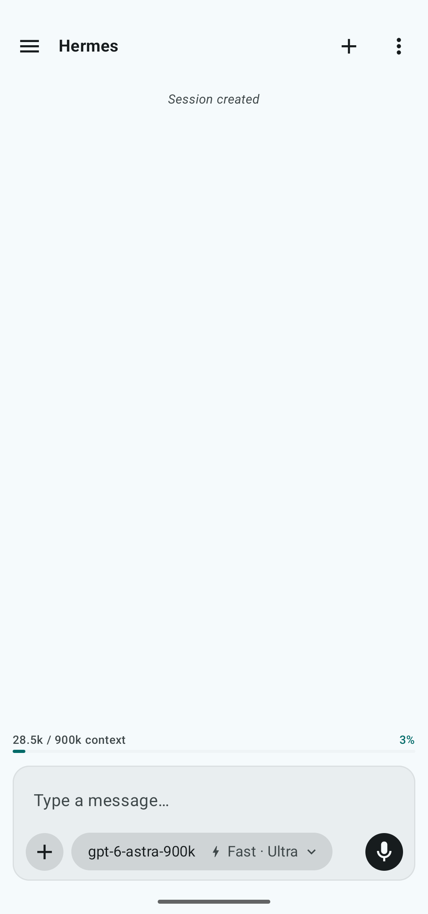
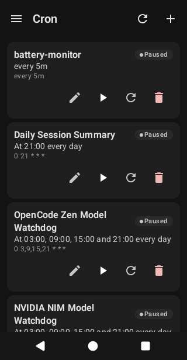
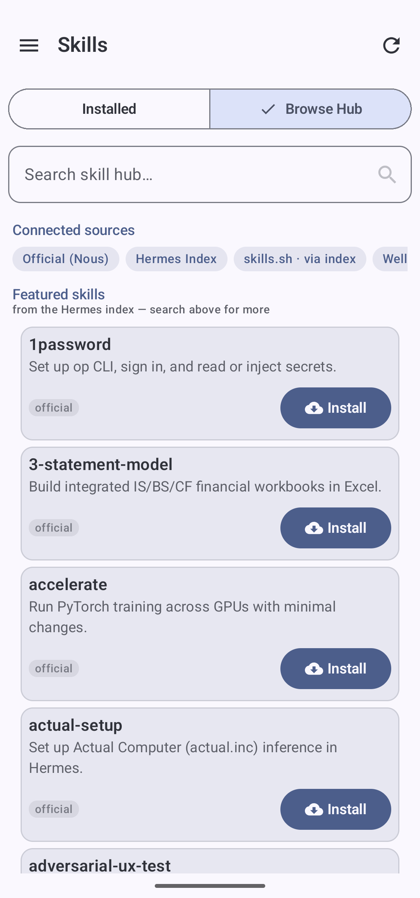
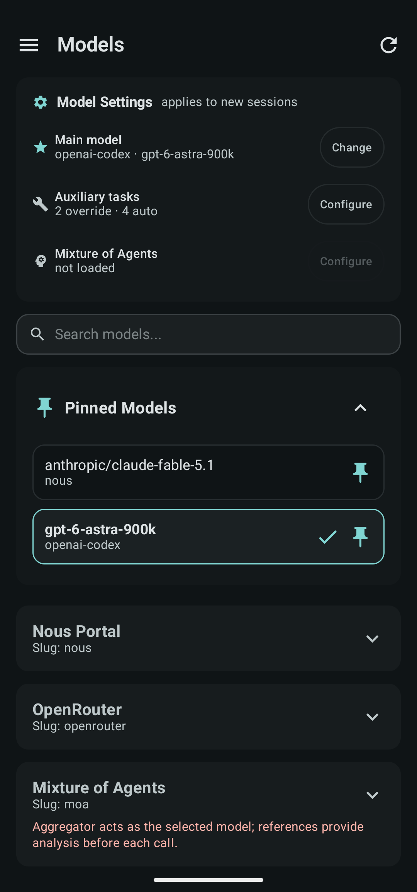
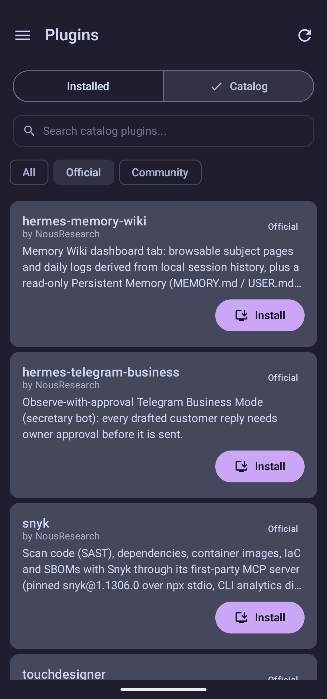
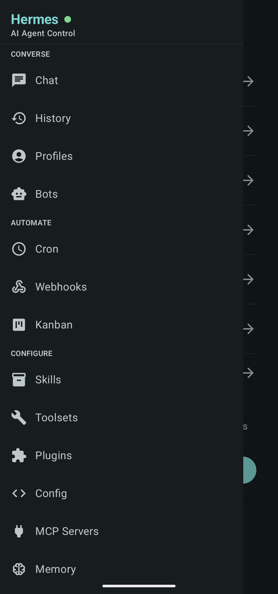
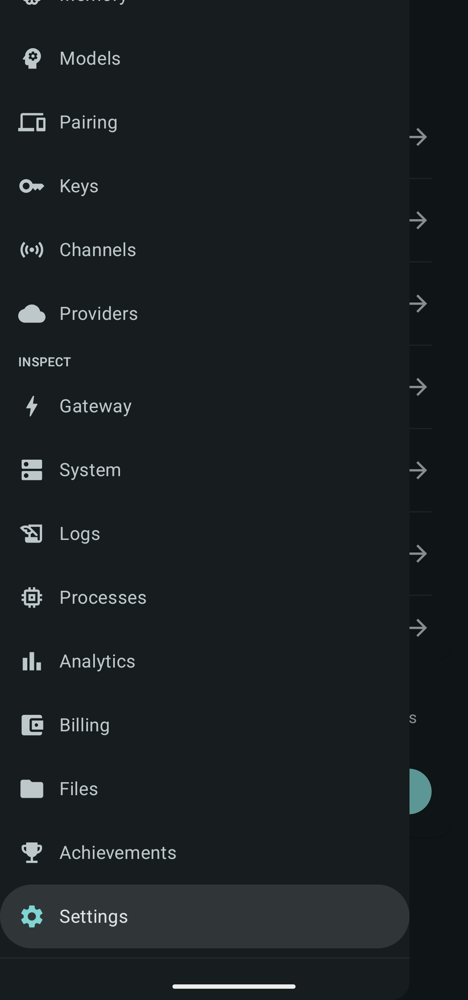

<h1 align="center">Hermes Mobile</h1>
<p align="center"><strong>Native Android companion app for your Hermes AI agent.</strong></p>

<div align="center">
  <br>
  
  
  
  
  <br><br>
</div>

<p align="center">
  <a href="https://github.com/Hy4ri/hermes-mobile/releases/latest"></a>
  
  
  
</p>

<p align="center">
  <a href="https://f-droid.org/packages/com.m57.hermescontrol/">
    
  </a>
  <a href="https://apps.obtainium.imranr.dev/redirect?r=obtainium%3A%2F%2Fadd%2Fhttps%3A%2F%2Fgithub.com%2FHy4ri%2Fhermes-mobile">
    
  </a>
</p>

---

## Overview

Hermes Mobile is a native Android app for your [Hermes Agent](https://hermes-agent.nousresearch.com). Chat with your agent and manage cron jobs, skills, models, and more from your phone.

The app connects to the Hermes dashboard over its REST API and WebSocket gateway, so the dashboard must run on a host your phone can reach.

---

## Screenshots

<p align="center">
  
  
  
  
</p>

<p align="center">
  
  
  
</p>

---

## Features

- Chat with your agent. History is stored locally in Room, and notifications support inline replies.
- Enable **Notify when a session completes** for cron results on the selected profile while the app stays connected in the background. The cron API exposes each job’s latest result, so quick successive runs can appear as one alert.
- Manage profiles, skills, plugins, toolsets, and model/provider selections.
- Stream and filter live logs, manage cron jobs, edit environment keys, test webhooks, and monitor processes.
- Check the WebSocket connection, MCP servers, messaging channels, and OAuth providers.
- Manage tasks on Kanban boards, track agent milestones, and browse session history.
- Long-press the app icon for New Chat, History, and recent conversations (launcher support required).
- See usage analytics and manage billing or subscriptions.
- Pick one of seven theme presets (Default, Monochrome, Gruvbox, Catppuccin, AMOLED, Nord, Garnet) or Material You dynamic colors on supported devices.

---

## Quick start

1. Install Hermes Mobile from [F-Droid](https://f-droid.org/packages/com.m57.hermescontrol/) or [Obtainium](https://apps.obtainium.imranr.dev/redirect?r=obtainium%3A%2F%2Fadd%2Fhttps%3A%2F%2Fgithub.com%2FHy4ri%2Fhermes-mobile), or download the APK from the [latest GitHub release](https://github.com/Hy4ri/hermes-mobile/releases/latest).
2. On the Hermes host, start the dashboard so your phone can reach it:

   ```bash
   hermes dashboard --host 0.0.0.0
   ```

   The dashboard asks for a login when it listens beyond localhost. Set it up with the [Hermes Web Dashboard guide](https://hermes-agent.nousresearch.com/docs/user-guide/features/web-dashboard#usernamepassword-provider-no-oauth-idp).
3. Open the app, tap **Sign in**, enter the dashboard host and port, and log in.

Use HTTPS when the dashboard is reachable outside your local network. Plain HTTP does not encrypt the connection.
See [Connecting to Hermes](https://github.com/Hy4ri/hermes-mobile/wiki/Connecting-to-Hermes) for token login, SSH tunnels, and other setups.

---

## Documentation

The [wiki](https://github.com/Hy4ri/hermes-mobile/wiki) has the details:

- [Connecting to Hermes](https://github.com/Hy4ri/hermes-mobile/wiki/Connecting-to-Hermes)
- [TLS and mTLS](https://github.com/Hy4ri/hermes-mobile/wiki/TLS-and-mTLS)
- [Cloudflare Access and custom headers](https://github.com/Hy4ri/hermes-mobile/wiki/Cloudflare-Access-and-Custom-Headers)
- [SSH tunnel](https://github.com/Hy4ri/hermes-mobile/wiki/SSH-Tunnel)
- [App lock and profile lock](https://github.com/Hy4ri/hermes-mobile/wiki/App-Lock-and-Profile-Lock)
- [Chat drafts and launcher shortcuts](https://github.com/Hy4ri/hermes-mobile/wiki/Chat-Drafts-and-Launcher-Shortcuts)
- [Verify a release APK](https://github.com/Hy4ri/hermes-mobile/wiki/Installation#verify-a-github-release-apk)
- [Building from source](https://github.com/Hy4ri/hermes-mobile/wiki/Building-from-Source)

---

## Contributing

Contributions are welcome. Read [CONTRIBUTING.md](CONTRIBUTING.md) for the branch workflow, code style, and PR checklist.

- Translate the app on [Hosted Weblate](https://hosted.weblate.org/projects/hermes-mobile/hermes-mobile/).
- Conventions and architecture are in [AGENTS.md](AGENTS.md).
- Visual and interaction rules are in [DESIGN.md](DESIGN.md).
- Theme implementation is in [THEMES.md](app/src/main/java/com/m57/hermescontrol/theme/THEMES.md).

To build a debug APK you need JDK 21+ and an Android SDK:

```bash
git clone https://github.com/Hy4ri/hermes-mobile.git
cd hermes-mobile
./gradlew assembleDebug
```

[Building from source](https://github.com/Hy4ri/hermes-mobile/wiki/Building-from-Source) covers release signing, the Nix emulator, and the project layout.

---

## Support the project

If Hermes Mobile is useful to you, you can support its development on [Ko-fi](https://ko-fi.com/m_5_7).

---

## License

Copyright © 2026 M57 (Hy4ri).

Licensed under the Apache License, Version 2.0. See the [LICENSE](LICENSE) file for details.
